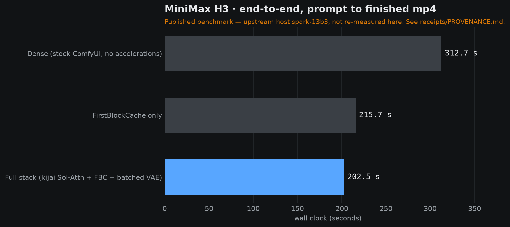
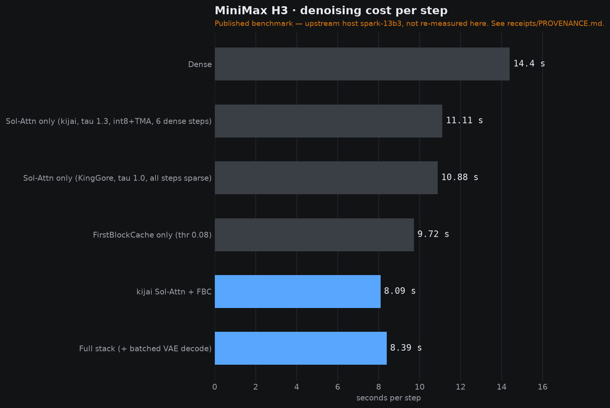

# Keel

**Accelerated MiniMax H3 video diffusion inference on a single DGX Spark.**

An efficiency-oriented inference stack for MiniMax H3 — installable ComfyUI node packs, a
resident-weight recipe, and a receipt behind every number.

---

**Keel is** a way to run MiniMax H3 — a 33B joint video-and-audio diffusion model — on one
128 GB DGX Spark, for people who want to render H3 themselves rather than call an API. It ships
three installable ComfyUI node packs, the weight set that actually fits in unified memory, a
seed-matched A/B method so you can measure the difference on your own box, and a checker that
fails the build if a published number stops matching its receipt.

**Keel is not** NVIDIA's Sol-Engine, and it does not try to be. Sol-Engine is their inference
codebase with their own kernels — `Sol-Attn` is their name for their method. Keel is the ComfyUI
side of the same problem: the node packs, the resident-weight recipe, the step-distillation
adapters, and the discipline around the numbers. The published speed ladder that appears below
belongs to the community Sol-Engine port, and Keel says so wherever it appears.

**Keel is going** in one direction, and it is not a new kernel. The published ladder reaches
**1.54×** end-to-end on a single Spark using two components — the Sol-Attn kernel and the
batched VAE decode — that **this team has never installed and never measured**. Closing that gap
is the next run, and `RECIPE.md` is written for it. Everything else Keel does is already here.

---

## Baseline comparison

One table. Every row is either **PUBLISHED** — measured by somebody else, from the repository
named — or **FIRST-PARTY** — measured by this team, with the receipt in this repository. The two
are never blended, and the geometries are not the same, so read the columns, not just the speedup.

| Engine | Hardware | Geometry | Steps | Seconds | Speedup | Source |
|---|---|---|---:|---|---:|---|
| **Stock MiniMax H3** — no acceleration | DGX Spark, GB10 | 832×480, 124f | 50 | 710.6 s | 1.00× | PUBLISHED · NVlabs/Sana `sol-engine` |
| **NVlabs Sana Sol-Engine** — full opt | DGX Spark, GB10 | 832×480, 124f | 50 | **181.3 s** | **3.92×** | PUBLISHED · NVlabs/Sana `sol-engine` |
| **Stock ComfyUI** — no acceleration | DGX Spark, `spark-13b3` | 864×480, 124f | 20 | 312.7 s | 1.00× | PUBLISHED · community SM121 port |
| **Community Sol-Engine port** — full stack | DGX Spark, `spark-13b3` | 864×480, 124f | 20 | **202.5 s** | **1.54×** | PUBLISHED · community SM121 port |
| **ComfyUI-Sol-H3 (xmarre)** — SOL on, default | RTX PRO 6000, SM120 | not stated | not stated | 420.81 → **400.94 s** | 1.05× | PUBLISHED · xmarre/ComfyUI-Sol-H3 |
| **ComfyUI-Sol-H3 (xmarre)** — SOL on, speed mode | RTX PRO 6000, SM120 | not stated | not stated | 420.81 → **380.57 s** | 1.11× | PUBLISHED · xmarre/ComfyUI-Sol-H3 |
| **Keel** — acceleration vs plain control | DGX Spark, GB10 | 1280×704, 124f | 8 | 496 → **344 s** | **1.44×** | **FIRST-PARTY** · `receipts/bench-matrix.tsv` |
| **Keel** — acceleration vs plain control | DGX Spark, GB10 | 1280×704, 124f | 16 | 635 → **545 s** | **1.17×** | **FIRST-PARTY** · `receipts/bench-matrix.tsv` |
| **Keel** — 4-step turbo LoRA | DGX Spark, GB10 | 1280×704, 124f | 4 | **201 s** | **3.16×** | **FIRST-PARTY** · `receipts/bench-matrix.tsv` |

Read it this way:

* **NVIDIA's 3.92× is the strongest number here** and it is theirs, measured on their runtime
  with their kernels, at 832×480 and 50 steps.
* **The community port's 1.54×** is the strongest number for a *ComfyUI node-pack* stack on one
  Spark. It is theirs, measured on `spark-13b3`, and Keel reproduces it with attribution rather
  than claiming it.
* **Keel's own rows are 1.44× and 1.17×**, plus **3.16×** from step distillation. They are lower
  than the published ladder for a stated reason: the two components that ladder depends on —
  the Sol-Attn kernel and the batched VAE decode — were never installed in our runs. Keel is the
  only row here whose accelerator is a ComfyUI node pack, which is also the only column we can
  re-run and check.
* **xmarre's rows** are the careful ones: they publish a matched A/B, they state that the speed
  mode is a quality trade rather than a free win, and they do not publish the geometry for those
  timings. We left the geometry column blank rather than guess it.

---

## The technique: Trim

**Trim** is Keel's named technique, and it is the owner's to rename. NVIDIA's is Sol-Attn; ours
is the set of choices that make one machine enough, plus the method of proving they work.

Trim means three things, in order: **fit the model to the machine, cut the steps, then measure
the cut.**

| | What it does | Weights it touches | Measured effect |
|---|---|---|---|
| **Trim-Residency** | Picks the weight set that fits in the 121 GB a Spark actually shows the runtime: a pruned FP8 DiT and an NVFP4/AWQ encoder instead of the BF16 pair. | `minimax_h3_fl2va_pruned_fp8_scaled.safetensors` (20.96 GB), `qwen3vl_32b_minimax_h3_nvfp4_awq.safetensors` (15.69 GB) | **42.46 GB** for DiT + encoder + both VAEs, against 123.60 GB for the BF16 pair — the difference between running and not running. The precision cost is nil: NVIDIA measure their FP8 baseline at 13,428 ms/step against the BF16 model's 13,417 ms, a **0.08 % difference**. *(FP8 cost: PUBLISHED · NVIDIA. Residency: FIRST-PARTY.)* |
| **Trim-INT8** | The convert path for machines with more room: INT8 ConvRot DiTs at 34.04 GB, or the pruned INT8 Convrot DiTs at 20.97 GB, in place of the BF16 66.28 GB. | `minimax_h3_fl2va_int8_convrot.safetensors` (34.04 GB), `minimax_h3_fl2va_pruned_int8_convrot.safetensors` (20.97 GB) | **No speed measurement of its own.** It is a residency choice, not an acceleration. *(Unmeasured as a separate effect — stated plainly.)* |
| **Trim-NVFP4** | The INT4 conditioner, and the download discipline that goes with it: quote a checkpoint size from the safetensors header, never from `stat`. | `qwen3vl_32b_minimax_h3_nvfp4_awq.safetensors` (15.69 GB) | Caught a **21,714,795,671-byte** encoder with **6,027,653,120 bytes** of trailing garbage behind a healthy header, and a **truncated BF16 DiT** 30.6 GB short of its own header. *(FIRST-PARTY — `receipts/encoder-diagnosis.md`.)* |
| **Trim-Step** | Step distillation. A 4-step or 8-step turbo LoRA replaces 20 sampling steps. | `minimax_h3_fl2v_turbo_4step_v1.0_768p_comfyui_bf16.safetensors` (1.96 GB) and siblings | **201 s** for a 4-step 1280×704 render against the 635 s 16-step plain baseline — **3.16×**. A step-count reduction as much as an acceleration, and a quality trade rather than a free win. *(FIRST-PARTY.)* |
| **Trim-A/B** | The measurement method: a control and a treatment that differ *only* in the acceleration, on the same seed, the same geometry, the same step count, the same scheduler. | none | **1.44×** at 8 steps, **1.17×** at 16 steps, against matched plain controls. *(FIRST-PARTY — `receipts/bench-matrix.tsv`.)* |
| **Trim-Receipts** | The discipline: every published number maps to who measured it, and a checker fails the build when a number loses its receipt. | none | Not a speed effect. It is the reason the other five rows can be trusted. *(FIRST-PARTY — `scripts/check_receipts.py`.)* |

**Two things Trim does not claim.** It does not claim per-technique speedups where none were
isolated — Trim-INT8 has no number of its own, and Trim-A/B cannot separate Sage attention from
FirstBlockCache, because the surviving records do not resolve which of the two produced the gain.
And it does not claim the published 1.54×: our acceleration arms never had the Sol-Attn kernel or
the batched VAE decode installed.

---

## Results

### The published speed ladder

Measured by the author of the community Sol-Engine port for a single DGX Spark, on their host
`spark-13b3`, and published in their repository. Reproduced here verbatim, with attribution.

**End-to-end — prompt to finished mp4.** 864×480, 124 frames (5.17 s @ 24 fps), 20 steps, same
prompt and seed 46 across the ladder.

| Config | Wall | vs dense |
|---|---:|---:|
| Dense (stock ComfyUI, no accelerations) | 312.7 s | 1.00× |
| FirstBlockCache only | 215.7 s | 1.45× |
| **Full stack (kijai Sol-Attn + FirstBlockCache + batched VAE decode)** | **202.5 s** | **1.54×** |

**Denoising cost per step.**

| Config | s/step | vs dense |
|---|---:|---:|
| Dense | 14.40 | 1.00× |
| Sol-Attn only (kijai, tau 1.3, INT8+TMA, 6 dense steps) | 11.11 | 1.30× |
| Sol-Attn only (KingGore, tau 1.0, all steps sparse) | 10.88 | 1.32× |
| FirstBlockCache only (threshold 0.08) | 9.72 | 1.48× |
| kijai Sol-Attn + FirstBlockCache | 8.09 | 1.78× |
| **Full stack (+ batched VAE decode)** | **8.39** | **1.72×** |

**Batched VAE tile decode**, one temporal chunk at 864×480, warm: 4.871 s sequential → **2.933 s
batched (1.66×)**. Output is `allclose`, not bit-identical — batch size changes fp16 kernel
selection. Max abs diff 1.56e-2, mean 5.29e-4 on a [-1,1] pixel range.




> **Where these numbers come from.** They are **not** measurements this team took. They are the
> published benchmark of `drowzeys/keys-SM121-Optimized-MiniMax-H3-Nvidia-Sol-Engine-Kijai-SolAttn_Triton-Single-DGX-Spark`
> at commit `7e3db54`, reproduced byte-for-byte in `receipts/bench-results.md`. This team did not
> re-run this ladder on our own hardware. See **What we measured ourselves** below for the
> first-party numbers, and `receipts/PROVENANCE.md` for the number-by-number map.

### What we measured ourselves

First-party numbers, on our own DGX Spark, each with its own receipt.

| Measurement | Result | Receipt |
|---|---|---|
| Pruned FP8 FL2VA DiT, the checkpoint we actually run | 20,958,205,608 B (21.0 GB), SHA-256 `12944c1f…` — matches the published hash exactly | `receipts/verification.json` |
| NVFP4/AWQ Qwen3-VL-32B encoder, re-downloaded clean | 15,687,142,551 B (15.7 GB) | `receipts/verification.json` |
| The same encoder, first download | 21,714,795,671 B — 6,027,653,120 unaccounted trailing bytes | `receipts/encoder-diagnosis.md` |
| A real H3 forward pass **and** video+audio decode, 512×288, 124 frames, 2 steps | **30.02 s** | `receipts/forward-receipt.json` |
| Acceleration arms vs plain control, 8 steps, 1280×704 | 496 s → **344 s** — **1.44×** | `receipts/bench-matrix.tsv` |
| Acceleration arms vs plain control, 16 steps, 1280×704 | 635 s → **545 s** — **1.17×** (39.8 → 34.1 s/step) | `receipts/bench-matrix.tsv` |
| 4-step turbo LoRA, 1280×704 | **201 s** against the 16-step plain baseline — **3.16×** | `receipts/bench-matrix.tsv`, `receipts/adapter-shelf.md` |
| Spillway keeper render, 1024×576, 192 frames, 20 steps | 710.15 s (S01) · 710.13 s (S02) · 710.14 s (S03) | `receipts/spillway-keepers.md` |
| Checkpoint sizes, every published variant, byte-exact | 66.3 GB BF16 · 34.0 GB INT8 ConvRot · 21.0 GB pruned FP8 | `receipts/checkpoint-sizes.md` |

### The honest gap

Three things Keel will not pretend:

1. **We did not reproduce the published ladder, and our own number is lower.** Our acceleration arms
   measured **1.44×** against a plain control at 8 steps and **1.17×** at 16 steps, at 1280×704.
   The published ladder is 1.54× end-to-end and 1.72× per step — and it includes two things our
   runs did not: **the Sol-Attn kernel was never installed on this box, and the batched VAE decode
   node was never enabled.** The Sol-Attn stack is therefore *unproven here, not disproven*. The
   published ladder remains a published benchmark, and our figure remains ours.
   The largest first-party speedup we hold is not the attention work at all — it is the
   **4-step turbo LoRA at 201 s, 3.16×** against the 16-step plain baseline, which is a
   step-count reduction as much as an acceleration.
2. **The three Spillway keepers were rendered with `"accelerate": false`.** They are evidence for
   the production harness and the gates, not for the speed.
3. **We cannot separate Sage attention from FirstBlockCache.** The accelerated arms ran with both
   enabled, and the surviving records do not resolve which produced the gain. The Sage arm at the
   keeper's own geometry was **rejected before sampling** (`receipts/sage-attention-ab.md`). So the
   claim is "the acceleration arms as configured", not "technique X gave us 1.44×".

### The memory problem this stack actually solves

On a 128 GB Spark, precision is not a preference — it is residency. The pruned FP8 DiT plus the
NVFP4/AWQ encoder plus both VAEs is **42.46 GB**, comfortably inside the 121 GB the runtime sees.
The BF16 DiT alone is 66.28 GB, and the BF16 encoder is 51.51 GB; together with the VAEs that is
123.60 GB before a single activation is allocated.

| DiT | Encoder | + VAEs | Total | Fits 121 GB? |
|---|---|---|---:|---|
| BF16 66.28 GB | BF16 51.51 GB | 5.81 GB | 123.60 GB | No |
| BF16 66.28 GB | NVFP4 15.69 GB | 5.81 GB | 87.78 GB | Yes |
| INT8 ConvRot 34.04 GB | NVFP4 15.69 GB | 5.81 GB | 55.54 GB | Yes |
| **Pruned FP8 20.96 GB** | **NVFP4 15.69 GB** | 5.81 GB | **42.46 GB** | **Yes — the production pair** |

This is also why NVIDIA's own GB10 recipe uses a pruned FP8 DiT and an FP8 Qwen3-VL. Byte-exact
sizes and the reasoning are in `receipts/checkpoint-sizes.md`.

---

## What we did, in plain language

This is the part that does not fit in a table.

**We started from a link and a question.** In October 2026 the owner sent the team NVIDIA's
Sol-Engine branch for MiniMax H3 and asked how it managed to do what it does. A minute later came
an X post: a video of MiniMax H3 animating typography, and the question *"check this video how
did they do it with minimaxh3."* Sol-Engine was the answer, and it became the project.

**Then we found the thing that actually fits.** NVIDIA's Sol-Engine ships per-GPU runtimes for
GB10, GB200, H100, A100, RTX 4090 and RTX 5090 — SGLang-side, with its own model directories. What
a ComfyUI user needs is different: one Spark, node packs you can install, and a workflow you can
open. On 2026-10-21 we found the community port that does exactly that, plus two standalone
ComfyUI node packs covering the same ground from different directions. All three are vendored
here under `custom_nodes/`, each credited to its author, each left as its author shipped it.

**Then we did the part that was left.** NVIDIA's recipe and the community port both stop at "here
is the fast configuration". Keel is the part after that:

* the **residency work** — working out which checkpoints fit in unified memory and proving the
  bytes, including the pruned FP8 pair that makes the model fit at all;
* the **download discipline** — catching a text encoder that arrived with 6 GB of garbage behind a
  healthy header, and a BF16 DiT that stopped 30.6 GB short of its own header, before either cost
  a render;
* the **step distillation** — turbo LoRAs that cut 20 sampling steps to 4, measured at **3.16×**
  against the plain baseline;
* the **measurement method** — a seed-matched A/B where the control and the treatment differ only
  in the acceleration, and a checker that refuses to let the front page say anything a receipt
  does not back;
* the **production harness and craft layer** — a pinned toolset, motion and aliveness gates that
  refuse a slideshow and call it a video, a prompt cookbook, and six curated clips from a real
  production.

**And then the production stopped.** The owner halted the film lane on 2026-10-25. The three
Spillway keepers in `clips/` are what survived, and they are in this repository as keepers — not as
a finished film, and not as a speed demonstration.

---

## Install

**1 — Node packs.** Copy the three directories into your ComfyUI `custom_nodes/`:

```bash
cd /path/to/ComfyUI/custom_nodes
cp -r /path/to/keel/custom_nodes/H3-SolAttn-SM121   .
cp -r /path/to/keel/custom_nodes/H3-FirstBlockCache .
cp -r /path/to/keel/custom_nodes/H3-Motion-Context .
```

`H3-SolAttn-SM121` is the full port (Sol-Attn + FirstBlockCache + batched VAE + the GB10
spin-wait patch). It ships its own installer if you would rather point it at your ComfyUI:

```bash
bash custom_nodes/H3-SolAttn-SM121/install.sh --comfy-dir /path/to/ComfyUI
```

**2 — Weights.** Into `ComfyUI/models/`. Every file, with its size and published SHA-256, is in
[`receipts/weights.md`](receipts/weights.md). The pair that fits one Spark:

| Target | File | Bytes |
|---|---|---:|
| `diffusion_models/` | `minimax_h3_fl2va_pruned_fp8_scaled.safetensors` | 20,958,205,608 |
| `diffusion_models/` | `minimax_h3_ref2va_pruned_fp8_scaled.safetensors` | 20,958,205,608 |
| `text_encoders/` | `qwen3vl_32b_minimax_h3_nvfp4_awq.safetensors` | 15,687,142,551 |
| `vae/` | `minimax_h3_video_vae_fp16.safetensors` | 5,207,808,496 |
| `vae/` | `minimax_h3_audio_vae_fp32.safetensors` | 605,254,808 |

**3 — Workflow.** Open `workflows/h3-fullstack.json` for the accelerated path and
`workflows/h3-dense-baseline.json` for the control. Same prompt, same seed, same resolution — the
only difference is the acceleration nodes. See `workflows/README.md`.

**4 — Check your claim.** From the repository root:

```bash
python3 scripts/check_receipts.py
```

`RECIPE.md` is the same thing written for an agent instead of a person.

---

## Weights

**Keel ships no weights. Not one byte.** The complete inventory — every DiT variant, the text
encoder, both VAEs and the turbo LoRAs, with source, byte-exact size, published SHA-256, and what
we did to each one (untouched, re-downloaded, or distilled) — is in
[`receipts/weights.md`](receipts/weights.md).

Short version: every checkpoint in this project is **published by someone else and downloaded by
us**, with one exception — the step-distillation adapters in the H3 turbo shelf, which are also
published. What this team produced is its own LoRA *work*, catalogued in
[`training/TRAINING.md`](training/TRAINING.md), and no trained adapter ships here either.

Whether Keel should ever host and publish weights is on the owner's list. The costs and the trade
are written out in `receipts/weights.md` and in `LAUNCH-PACKET.md`. It does not happen by default.

---

## The curated set

Six clips. Three finished films and three Spillway keeper shots. Hashes, geometry and the exact
status of each one are in `clips/INDEX.md`; `scripts/check_receipts.py` re-hashes them on every
run and fails if the set changes.

| | Clip | What it is |
|---|---|---|
| 1 | `spillway-s01-keeper.mp4` | Spillway S01 take 5 — **owner-locked keeper**, 710.15 s |
| 2 | `spillway-s02-keeper.mp4` | Spillway S02 take 2 — **owner-locked keeper** after a source-grounded re-review, 710.13 s |
| 3 | `spillway-s03-keeper.mp4` | Spillway S03 take 2 — **pre-halt agent selection, not owner-locked**, 710.14 s |
| 4 | `FILM-WAR-30s-1080p.mp4` | Finished film, 1920×1056, 31.104 s |
| 5 | `FILM-BEACON-30s-1080p.mp4` | Finished film, 1920×1056, 31.104 s |
| 6 | `FILM-BRIDGE-30s-1080p.mp4` | Finished film, 1920×1056, 31.104 s |

---

## Four things that will cost you a day if you don't know them

**1 — `torch flex_attention` is wrong on Blackwell.** It compiles, it runs, and it does not error.
Cosine similarity against dense SDPA is **0.9167 at S=1536** and **0.9688 at S=4096**. The error
compounds across 50 blocks × 20 steps into visible noise. The working alternatives measure
0.99995–0.99998. Do not reach for `flex_attention` on `sm_121`.

**2 — a download can be broken and still look right.** Twice, on this project, and both times the
file had the right name.

The text encoder arrived at 21,714,795,671 bytes with a header declaring the right length and
6,027,653,120 bytes of garbage behind it. It loads. It produces nothing. It does not error.

The BF16 DiT arrived at 35,660,245,251 bytes with a header declaring **66,280,487,368**. It is
30,620,242,117 bytes short and cannot load at all. That truncated file's size is where this
repository's old "35.7 GB BF16" claim came from — it was `ls -l` output read as a model size.

**Quote a checkpoint size from the safetensors header, never from `stat`.** The header is what
the file promises to be; the size on disk is only what survived the download.
`receipts/encoder-diagnosis.md` and `receipts/checkpoint-sizes.md` have both cases and the check.

**3 — FirstBlockCache's step curve is U-shaped, not monotone.** The per-row diff ratio falls from
.179 at step 1 to a minimum around step 10 and climbs back to .249 by step 19. With the guards
(`start_step=3`, `end_dense_steps=2`, `max_consecutive_skips=2`) it skips 6 of 20 steps — 6, 7, 9,
10, 12, 13 — but the tail is where it gets expensive again. Set the guard from the curve, not from
a gut feel.

**4 — two Sparks over Ethernet is slower than one Spark.** Context parallelism across two nodes
runs at 5.52 GB/s over fabric against 503 GB/s over NVLink. Splitting the render across two
machines loses far more than the parallelism wins. This is why the whole stack here is designed
to run on one box.

---

## Requirements

* NVIDIA DGX Spark (GB10, `sm_121`), or any Blackwell-class board with ≥ 64 GB unified memory
* ComfyUI on `aarch64`, CUDA 13, torch 2.11+
* The `pinned-h3` production toolset under `production/tools/pinned-h3/` (Python 3.11, `opencv-python`,
  `numpy`)
* For the craft gates: `opencv-python` and `numpy`

## Repo layout

```
keel/
├── README.md                       this page
├── RECIPE.md                       the same thing written for an agent
├── LAUNCH-PACKET.md                internal: state, gaps, checklist, owner decisions
├── charts/                         the ladder, and the script that draws it
├── clips/                          the curated set — six clips, indexed and hashed
│   ├── INDEX.md
│   ├── spillway-s01-keeper.mp4
│   ├── spillway-s02-keeper.mp4
│   └── spillway-s03-keeper.mp4
├── craft/                          the craft layer
│   ├── PROMPT-COOKBOOK.md
│   └── gates/                      motion, aliveness, control, face
├── custom_nodes/                   three ComfyUI node packs, each credited
│   ├── H3-SolAttn-SM121/           Sol-Attn + FBC + batched VAE + spin-wait patch + workflows
│   ├── H3-FirstBlockCache/         standalone FirstBlockCache pack
│   └── H3-Motion-Context/          clip chaining across joins
├── docs/                           deployment guide
├── production/                     pinned harness, workflow config, stills manifest
├── receipts/                       every number, and where it came from
│   ├── PROVENANCE.md               number-by-number map — start here
│   ├── weights.md                  every weight: source, size, SHA-256, what we did
│   ├── published-comparisons.md    NVIDIA's and xmarre's published numbers, quoted
│   ├── bench-results.md            the published ladder, verbatim, attributed
│   ├── bench-matrix.tsv            our own first-party benchmark, verbatim
│   ├── checkpoint-sizes.md         byte-exact size table and the residency math
│   ├── spillway-keepers.md         the three keepers, their lock status, the halt
│   ├── our-acceleration-ab.md      our own A/B: 1.44x at 8 steps, 1.17x at 16
│   ├── adapter-shelf.md            the turbo LoRAs, with verified hashes
│   ├── spin-wait-patch.md          the GB10 spin-wait patch, and who measured it
│   ├── verification.json           model-file hashes and tensor dtype counts
│   ├── forward-receipt.json        a real forward pass and decode
│   ├── keeper-receipt.json         the S01 keeper, with motion metrics
│   ├── sage-attention-ab.md        the A/B that found no gain
│   ├── encoder-diagnosis.md        the corrupt encoder, and the fix
│   └── CURATION-NOTE.md            why the set is six
├── scripts/
│   ├── check_receipts.py           fails the build if a claim stops matching its receipt
│   └── make_demo.py                rebuilds the demo video from the repo
├── workflows/                      the A/B pair — same seed, same geometry
│   ├── README.md
│   ├── h3-dense-baseline.json
│   └── h3-fullstack.json
└── training/                       turbo LoRA shelf and its training config
```

`.github/workflows/claims.yml` runs `scripts/check_receipts.py` on every push and every pull
request, so a claim that loses its receipt fails the build rather than shipping.

## Credits

*The product name* **Keel** *and the technique name* **Trim** *are proposed in this rework and are
the owner's to approve. See `LAUNCH-PACKET.md` §1a and §5.*

**NVIDIA Sol-Engine** — the original. `NVlabs/Sana` branch `sol-engine`, including the per-GPU
MiniMax H3 runtimes, the GB10 recipe, and the Sol-Attention design.
<https://github.com/NVlabs/Sana/tree/sol-engine>

**drowzeys** — the community port for a single DGX Spark, and the published benchmark this
repository reproduces with attribution.
<https://github.com/drowzeys/keys-SM121-Optimized-MiniMax-H3-Nvidia-Sol-Engine-Kijai-SolAttn_Triton-Single-DGX-Spark>

**KingGore** — the Blackwell ComfyUI Sol-Attn pack, vendored pre-patched for `sm_121`.
<https://github.com/KingGore/ComfyUI_sol-attn_Blackwell>

**kijai** — the Triton Sol-Attn variant and the ComfyUI node base.
<https://github.com/kijai/ComfyUI-SolAttn_triton>

**duckyshell** — the standalone FirstBlockCache ComfyUI pack.
<https://github.com/duckyshell/ComfyUI-MiniMaxH3-FirstBlockCache>

**NikoDemon80** — Motion-Context, clip chaining that survives a join.
<https://github.com/NikoDemon80/ComfyUI-H3-Motion-Context>

**xmarre** — ComfyUI-Sol-H3, the ComfyUI-native Sol integration, and the matched A/B discipline
this project's own method was written in the light of.
<https://github.com/xmarre/ComfyUI-Sol-H3>

**Comfy-Org** — the H3 checkpoints, including the pruned FP8 DiT and the NVFP4/AWQ encoder.
<https://huggingface.co/Comfy-Org/MiniMax-H3>

**MiniMax** — H3 itself.
<https://huggingface.co/MiniMaxAI/MiniMax-H3>
