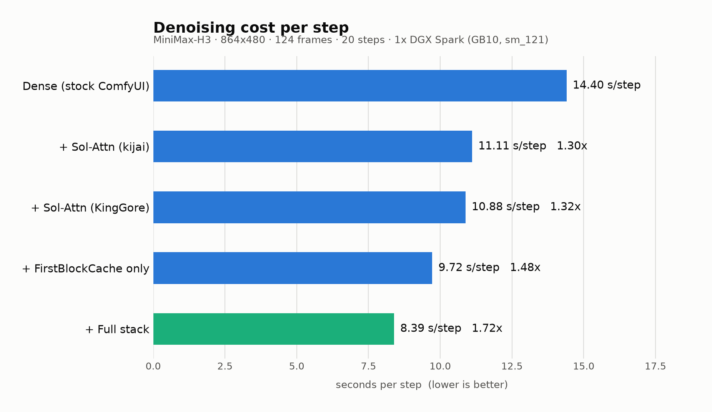
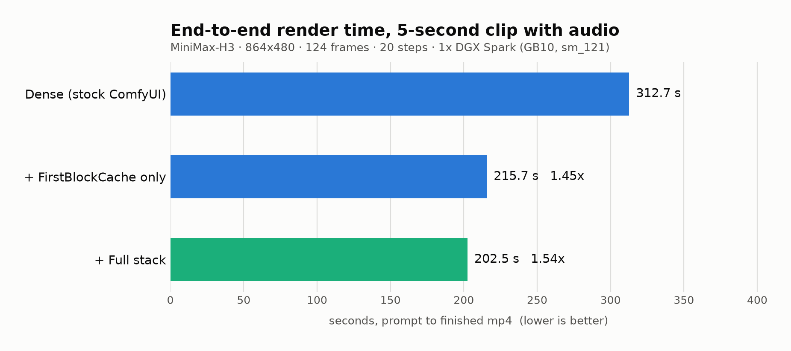

# keys-SM121-Optimized-MiniMax-H3 + NVIDIA Sol-Engine + kijai SolAttn_Triton — single DGX Spark

MiniMax-H3 (33 B audio+video Omni-DiT) running in ComfyUI on **one** NVIDIA DGX Spark
(GB10, `sm_121`, 128 GB unified), with NVIDIA's Sol-Engine acceleration line ported to
single-GPU and every kernel numerically verified on this architecture.

**312.7 s → 202.5 s** for a 5-second 864×480 clip with native stereo audio (**1.54×**
end-to-end, **1.72×** per denoising step) — no quality loss visible in A/B frames.



> Everything here was measured on the machine in [`bench/results.md`](bench/results.md),
> on an idle GPU, seed-matched. Contended runs are reported separately rather than
> quietly averaged in.

---

## Results

| Config | s/step | End-to-end | vs stock |
|---|---:|---:|---:|
| Dense — stock ComfyUI | 14.40 | 312.7 s | 1.00× |
| + Sol-Attn only | 10.88 | — | 1.32× |
| + FirstBlockCache only | 9.72 | 215.7 s | 1.45× |
| **+ Full stack** | **8.39** | **202.5 s** | **1.54×** |



Isolated: **batched VAE tile decode 4.87 s → 2.93 s per chunk (1.66×)**.

## What this actually does for you

If you own a DGX Spark and want MiniMax-H3, this repo does four things:

**1. It stops H3 from producing garbage on this chip.** The least obvious and most
valuable part. Install the existing Sol-Attn plugin on a Spark and it detects Blackwell,
picks the `flex_attention` path — and that path is silently miscompiled on `sm_121`. No
error, no warning, just output that looks like a broken model. You would reasonably blame
the checkpoint, the quantization, or ComfyUI, and lose days there. This repo forces the
correct Triton kernel on compute 12.1 and names the symptom up front so anyone already
stuck can recognize it.

**2. It makes renders ~1.5x faster.** 313 s to 202 s for a 5-second clip, from
FirstBlockCache and batched VAE decode — two NVIDIA techniques that existed only inside a
multi-GPU SGLang stack until this port.

**3. It removes the assembly.** `./install.sh` does the whole thing: pinned ComfyUI, the
41 GB of weights, all four accelerations wired, tuned workflows on disk. Or hand
[`RECIPE.md`](RECIPE.md) to a coding agent and it builds the same stack while explaining
every knob.

**4. It tells you what not to try.** Everyone with more than one Spark asks whether the
render can be split across nodes. Measured answer: the fabric moves 5.52 GB/s against the
503 GB/s NVLink NVIDIA's numbers assume, so CP=2 comes out *slower* than one tuned node.
That is a week you don't have to spend finding out.

**What it does not do:** it only helps GB10 / `sm_121` — `install.sh` refuses to run
elsewhere, and RTX 5090 owners should use the upstream plugins unpatched. It does not
reach NVIDIA's 3.97x (that needed eight GB200s on NVLink; 1.54x is what one Spark
supports). And it does not make a single clip faster by adding nodes — the multi-node
script scales throughput, not latency.

## Install

```bash
git clone https://github.com/drowzeys/keys-SM121-Optimized-MiniMax-H3-Nvidia-Sol-Engine-Kijai-SolAttn_Triton-Single-DGX-Spark.git
cd keys-SM121-*
./install.sh              # ComfyUI v0.30.1 + 41 GB weights + all four accelerations
~/comfy/h3-comfy-launch.sh
```

Open `http://<host>:8188`, drag `~/comfy/h3-fullstack.json` onto the canvas, hit Run.
Headless:

```bash
curl -X POST http://127.0.0.1:8188/prompt -H 'Content-Type: application/json' \
  -d "{\"prompt\": $(cat ~/comfy/h3-fullstack.json)}"
```

`./install.sh --skip-weights` if you already have the Comfy-Org weights.
**[`RECIPE.md`](RECIPE.md) is the agent-executable version** — hand it to Claude Code or
Codex and it will build this from scratch, with the reasoning for each knob.

## What's in the stack, and why each part helps

H3 packs text, audio and video into **one** sequence (38,247 rows at 1344×768/124f) with
full self-attention over all of it. No CFG branch to elide, no cross-attention to cache —
attention is ~70 % of the hot path. So the wins are: make attention sparse, skip the
network entirely on steps where nothing changes, and fix launch-bound work outside the DiT.

| Optimization | Origin | What it does | Measured |
|---|---|---|---|
| **Sol-Attn** | [NVIDIA Sol-Engine](https://github.com/NVlabs/Sana/tree/sol-engine) kernels, packaged by [KingGore](https://github.com/KingGore/ComfyUI_sol-attn_Blackwell) & [kijai](https://github.com/kijai/ComfyUI-SolAttn_triton) | routes each query block to only the top-scoring KV blocks | 1.32× per step |
| **FirstBlockCache** | NVIDIA `cache_line.py` → **ported here** to ComfyUI | block 0 runs every step; if its residual barely moved, skip the other 49 and reuse the cached tail | 1.48× per step |
| **Batched VAE decode** | NVIDIA `vae_shard.py` → **ported here** | batches same-shape spatial tiles through the ViT decoder instead of one launch per tile | 1.66× on decode |
| **INT8 QK + TMA** | kijai | Sage-style smoothed-K INT8 exact branch + Blackwell TMA descriptors | buys quality headroom at equal speed |
| **AdaLN precompute** | NVIDIA `adaln.py` | ~13 B of 33 B is AdaLN branches whose outputs precompute | already in the pruned checkpoint |

**Deliberately not included** (single-GPU reality check): context parallelism / Ulysses
(NVIDIA's 3.97× used 8×GB200 on 503 GB/s NVLink), the fused-QKV collective and Triton
relayout kernels (they exist to feed that all-to-all), and the elementwise DiT fusions —
NVIDIA's own README calls ~3 % the honest ceiling there, and ComfyUI already fuses
`_mod_gate`/`_mod_scale_shift` in place.

## Three things that will cost you a day if you don't know them

**1. `flex_attention` is silently wrong on `sm_121`.** With torch 2.11.0+cu130 it
compiles, runs, raises nothing — and returns cosine similarity 0.92–0.97 vs SDPA. Across
50 blocks × 20 steps that compounds into visible garbage that looks like a broken
checkpoint. The upstream Sol-Attn plugin prefers this path on Blackwell; the patch in
`patches/` forces the Triton kernel on 12.1 instead. **Numerically check every kernel on
this arch.**

**2. H3's blocks mutate their input in place.** `DiTBlock.forward` ends in
`x[a:b].addcmul_(...)` and returns *the same tensor object*. Any cache computing
`output - input` gets exactly zero, concludes the model never changes, skips everything,
and emits a checkerboard. Clone before the block.

<details>
<summary>what that failure looks like</summary>

The cache reports `diff_ratio=0.0000 -> skip` on every step and the decode is pure
checkerboard noise. Fix is two `.clone()` calls, in `nodes/h3_fbc_node.py`.
</details>

**3. NVIDIA's cache threshold assumes 50 steps.** At 20 the per-row diff ratio is
U-shaped (0.18 → 0.066 at step 10 → 0.25); a bare threshold caches in the wrong places.
This port adds `start_step`, `end_dense_steps` and `max_consecutive_skips` to bound drift.
Also: their global-mean metric is diluted by the packed text/audio prefix rows, so this
port measures a per-row ratio over the trailing 60 % of rows.

Plus the two ambient ones: **never `--use-sage-attention` with H3** (pure noise,
[ComfyUI#15263](https://github.com/Comfy-Org/ComfyUI/issues/15263)), and **never benchmark
a busy GB10** — a background CUDA job reads exactly like thermal throttling
(10.88 → 20.77 s/step in our case).

## Running NVIDIA's own Sol-Engine code

NVIDIA's official `sol_attn` package **does** run on `sm_121` — its CuTe table stops at
`sm_120`, but it falls back to a bundled Triton implementation for any capability ≥ 8.0.
Measured 3.51 ms vs kijai's 3.33 ms at an H3-shaped call, identical accuracy. Their full
*runtime* does not fit (bf16 needs 141 GB against 121 GB usable), and context parallelism
over a Spark fabric measures **5.52 GB/s** against the 503 GB/s NVLink their 3.97× assumed —
making CP=2 a net loss. Numbers and reasoning in [`RECIPE.md`](RECIPE.md#appendix-running-nvidias-own-sol-engine-code-measured-not-speculated).

## Repo layout

```
install.sh                     one-shot installer (ComfyUI + weights + all accelerations)
RECIPE.md                      agent-executable recipe with per-optimization rationale
nodes/h3_fbc_node.py           FirstBlockCache port  (this repo, Apache-2.0)
nodes/h3_vae_batch.py          batched VAE tile decode port  (this repo, Apache-2.0)
patches/                       sm_121 diff against upstream Sol-Attn + upstream LICENSE
vendor/ComfyUI_sol-attn_Blackwell/   KingGore's plugin, pre-patched (Apache-2.0 + NOTICE)
workflows/h3-fullstack.json    the tuned graph used for every number here
workflows/h3-t2v-api.json      minimal T2V graph
workflows/h3-dense-baseline.json   no accelerations, for reproducing the baseline
scripts/h3-comfy-launch.sh     launcher (reserve-vram 8, CUDA 13 on PATH)
scripts/h3-dispatch.py         fan a batch of clips across several Sparks (data parallel)
scripts/deploy-h3-node3.sh     replicate this stack to another node over the fabric
charts/  bench/                figures and the raw measurements behind them
```

## Requirements

DGX Spark / GB10 (`sm_121`), 128 GB unified memory, aarch64, CUDA 13, torch ≥ 2.9
(tested 2.11.0+cu130), ComfyUI v0.30.1, ~45 GB free disk for weights.
`install.sh` asserts the compute capability and refuses to run elsewhere — the patches
here are specifically about 12.1, and on 12.0 (RTX 5090) you want the upstream plugins
unmodified.

Peak usage during a 5-second render leaves ~26 GB of 121 GB free; a 15-second clip
(362 frames, the model's maximum) leaves 10–13 GB and takes ~32 min.

## Credits

- **[MiniMax](https://huggingface.co/MiniMaxAI/MiniMax-H3)** — the H3 model and open weights.
- **[NVIDIA NVlabs Sol-Engine](https://github.com/NVlabs/Sana/tree/sol-engine)** (Apache-2.0) —
  Sol-Attn, FirstBlockCache and the batched-VAE technique. The two ports here are derived
  from their `models/minimax_h3/optimized/` code; the analysis in their README is what made
  the port tractable. [Paper](https://arxiv.org/abs/2607.24027).
- **[KingGore](https://github.com/KingGore/ComfyUI_sol-attn_Blackwell)** (Apache-2.0) —
  first ComfyUI packaging of Sol-Attn for Blackwell; vendored here pre-patched, with a
  NOTICE of changes as Apache-2.0 §4b requires.
- **[kijai](https://github.com/kijai/ComfyUI-SolAttn_triton)** — the Triton Sol-Attn
  implementation with INT8/TMA and sigma-window gating that this stack defaults to.
  *Not vendored:* that repo carries no license file, so `install.sh` clones it from
  upstream rather than redistributing it.
- **[Comfy-Org](https://huggingface.co/Comfy-Org/MiniMax-H3)** — repackaged INT8/NVFP4
  weights and the day-0 H3 nodes and templates in ComfyUI.

## License

Apache-2.0 (see [LICENSE](LICENSE)) — matching NVIDIA's Sol-Engine, from which
`nodes/h3_fbc_node.py` and `nodes/h3_vae_batch.py` are derived. Vendored third-party code
keeps its own license and notice.
