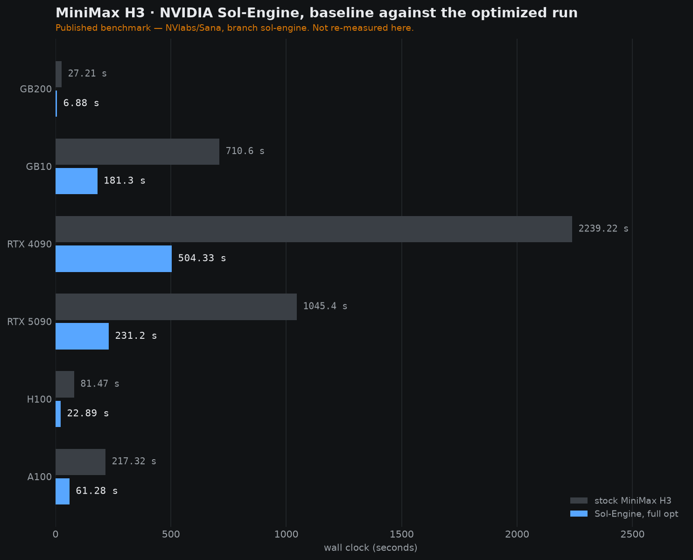
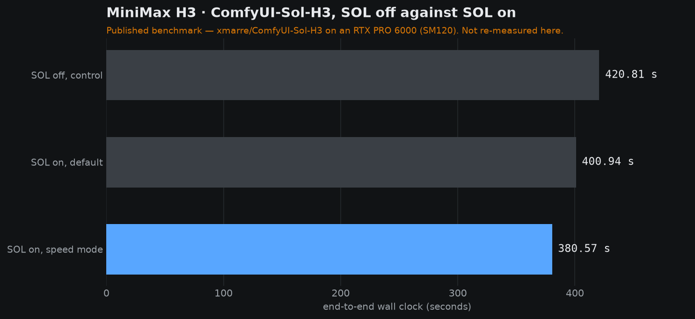
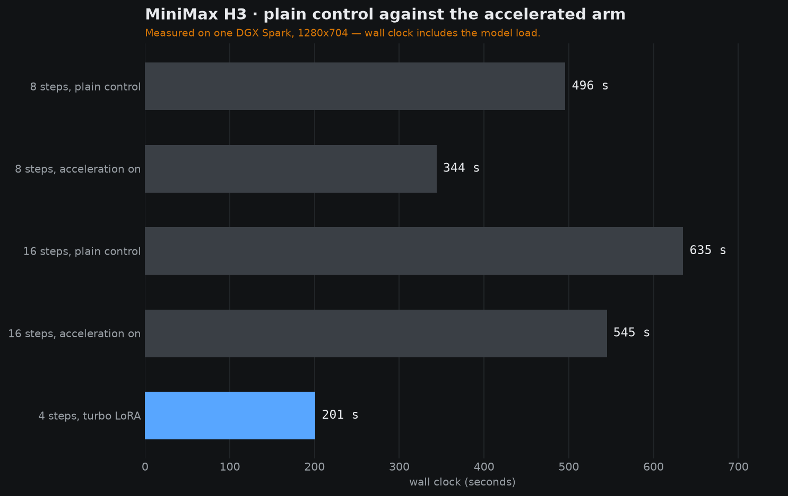
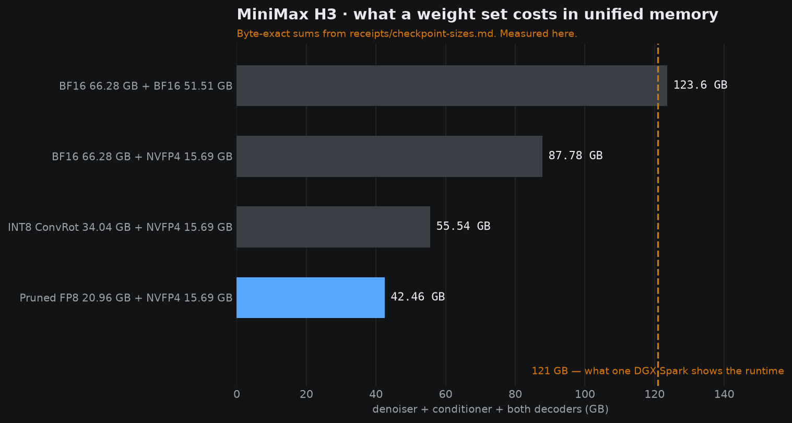

# Benchmarks

Every number on this page is one of two things, and the distinction is kept visible everywhere:

* **Published** — measured by somebody else and quoted here with the repository that measured it,
  the host it ran on, and the revision it was measured at.
* **Measured here** — taken on a DGX Spark and filed in `receipts/` with the host, the
  configuration, the wall time and, where there is a file, its SHA-256.

The two are never blended, and the geometries are not the same across the tables below. Read the
conditions under each table before you quote a figure from it.

Every chart on this page is generated from the receipt beside it, by `charts/make_charts.py`. A
number that changes in a receipt changes in the chart; a receipt edited without the chart
regenerated shows up as a diff.

---

## 1 — The published ladder: end to end

Measured by the author of the community Sol-Engine port for a single DGX Spark, on their host
`spark-13b3`, and published in their repository at commit `7e3db54`. Quoted here as the published
benchmark it is.

| Config | Wall | vs dense |
|---|---:|---:|
| Dense (stock ComfyUI, no accelerations) | 312.7 s | 1.00× |
| FirstBlockCache only | 215.7 s | 1.45× |
| Full stack (kijai Sol-Attn + FirstBlockCache + batched VAE decode) | **202.5 s** | **1.54×** |


<sub>**Conditions.** MiniMax H3 FL2VA pruned INT8 with a Qwen3-VL-32B NVFP4-AWQ text encoder, a
video VAE in fp16 and an audio VAE in fp32. 864×480, 124 frames (5.17 s at 24 fps), 20 steps,
`res_multistep` / `simple`, joint video and stereo-audio output. The same prompt and seed 46
across the ladder unless the row says otherwise. One idle DGX Spark, GB10, `sm_121`, 128 GB
unified, torch 2.11.0+cu130, ComfyUI v0.30.1. Source:
`drowzeys/keys-SM121-Optimized-MiniMax-H3-Nvidia-Sol-Engine-Kijai-SolAttn_Triton-Single-DGX-Spark`,
file `bench/results.md`. The verbatim table, with the hygiene notes, is
[`receipts/bench-results.md`](../receipts/bench-results.md).</sub>

---

## 2 — The published ladder: denoising cost per step

Same run set, read a different way. End-to-end and per-step ratios appear side by side in the
upstream table, and each is right for its own column.

| Config | s/step | vs dense |
|---|---:|---:|
| Dense | 14.40 | 1.00× |
| Sol-Attn only (kijai, tau 1.3, int8 + TMA, 6 dense steps) | 11.11 | 1.30× |
| Sol-Attn only (KingGore, tau 1.0, all steps sparse) | 10.88 | 1.32× |
| FirstBlockCache only (threshold 0.08) | 9.72 | 1.48× |
| kijai Sol-Attn + FirstBlockCache | 8.09 | 1.78× |
| Full stack (+ batched VAE decode) | 8.39 | 1.72× |


<sub>**Conditions.** Identical to the table above. `8.09` and `8.39` are the same sampling
configuration measured twice on different seeds, a ±4 % spread; the batched VAE decode changes
decode rather than sampling. The FirstBlockCache guards on this ladder skip 6 of 20 steps — steps
6, 7, 9, 10, 12 and 13.</sub>

### Two components, measured on their own

| Component | Before | After | Effect |
|---|---:|---:|---:|
| Batched VAE tile decode, 864×480, one temporal chunk, warm | 4.871 s | **2.933 s** | **1.66×** |
| `torch flex_attention` cosine similarity against dense SDPA | 1.0 | 0.9167 at S=1536, 0.9688 at S=4096 | wrong on Blackwell — see [`docs/performance-notes.md`](performance-notes.md) |

The batched decode output is `allclose` rather than bit-identical: the batch size changes which
fp16 kernel runs. The largest absolute difference is 1.56e-2 and the mean is 5.29e-4 on a
[-1, 1] pixel range, about 0.8 % on the worst pixel.

---

## 3 — NVIDIA's published figures

From `NVlabs/Sana`, branch `sol-engine`, section "Performance".

| Hardware | GPUs | Workload | Baseline | Optimized | Speedup |
|---|---:|---:|---:|---:|---:|
| GB200 | 8 | 768p@5s | 27.21 s | 6.88 s | **3.95×** |
| **GB10 (DGX Spark)** | 1 | 480p@5s | 710.6 s | 181.3 s | **3.92×** |
| RTX 4090 | 1 | 768p@5s | 2239.22 s | 504.33 s | **4.44×** |
| RTX 5090 | 1 | 768p@5s | 1045.4 s | 231.2 s | **4.52×** |
| H100 | 4 | 768p@5s | 81.47 s | 22.89 s | **3.56×** |
| A100 | 4 | 768p@5s | 217.32 s | 61.28 s | **3.55×** |



<sub>**Conditions.** The published table states that speedups are measured against the matching
baseline runtime on the same hardware, and that each platform uses its validated release
workload — so the table compares relative acceleration rather than absolute latency across GPUs.
The GB10 line comes from `config/minimax_h3/gb10_fullopt.toml`, which gives the geometry as
832×480, 124 frames, 50 steps. That release states no seed and no batch size. The same release
measures its pruned-FP8 GB10 baseline at 13,428 ms/step against the released BF16 model's
13,417 ms/step — a 0.08 % difference, which is what makes the FP8 substitution a residency
decision rather than a speed one. Source:
<https://github.com/NVlabs/Sana/tree/sol-engine>. The verbatim table is in
[`receipts/published-comparisons.md`](../receipts/published-comparisons.md).</sub>

---

## 4 — ComfyUI-Sol-H3's published figures

From `xmarre/ComfyUI-Sol-H3`, quoting their own metrics runs.

| Run | SOL | `dense_evaluations` | H3 sampler | End-to-end |
|---|---|---:|---:|---:|
| `metrics_00322` | off | — | 374.84 s | 420.81 s |
| `metrics_00321` | on | 1 | 353.36 s | **400.94 s** |
| `metrics_00323` | on | 0 | 332.56 s | **380.57 s** |



<sub>**Conditions.** An NVIDIA RTX PRO 6000 Blackwell Workstation Edition (SM120) with PyTorch
`2.10.0+cu130`. Their published timings state no resolution, no frame count and no seed, so
those cells stay blank on the front page rather than being guessed. The two SOL-on rows differ
from each other in a way their own README documents: with `dense_evaluations=0` the opening
motion showed an abrupt pose change before settling, while `dense_evaluations=1` kept a
continuous turn. Their own reading of the pair is a 9.6 % end-to-end reduction in the default
configuration and a deployment-specific figure rather than a universal percentage. Source:
<https://github.com/xmarre/ComfyUI-Sol-H3>.</sub>

---

## 5 — Measured here: the seed-matched A/B

The only first-party performance comparison in this repository. The artifact of record is
[`receipts/bench-matrix.tsv`](../receipts/bench-matrix.tsv) — 231 bytes, SHA-256
`4df15affc57556e9444faad08655f156c2cbaded585da6ef0fbd1346721bdace`.

| Comparison | Control | Accelerated | Ratio |
|---|---:|---:|---:|
| 8 steps, 1280×704, acceleration off vs on | 496 s | **344 s** | **1.44×** |
| 16 steps, 1280×704, plain baseline vs accelerated | 635 s | **545 s** | **1.17×** |
| 4 steps with the turbo LoRA, 1280×704 | 635 s (16-step plain) | **201 s** | **3.16×** |



<sub>**Conditions.** MiniMax H3, 1280×704, 124 frames, one DGX Spark (GB10). The control and the
treatment share the seed, the geometry, the step count, the scheduler and the sampler, and
differ only in the acceleration; the control runs with `accelerate: false`. Every row is
end-to-end, model load to written video, a single render with no batching. The wall times
include the model load — the run log records `[h3] loaded in 232.10s on cuda:0` — so they are
complete-render totals rather than sampler-only timings, and they read against a published table
that measures only the sampler with that difference in mind. The 16-step comparison is
corroborated by the per-step figures recorded in the same run: 39.8 s/step plain against
34.1 s/step accelerated. The matrix also carries a 480×832 pair — 16 steps plain at 198 s
against 8 steps accelerated at 111 s — which differs in step count as well as in acceleration, so
it is listed in the matrix and no ratio is drawn from it. Full record:
[`receipts/our-acceleration-ab.md`](../receipts/our-acceleration-ab.md).</sub>

---

## 6 — Measured here: what a weight set costs

The bytes decide whether a Spark runs the model at all, so they are worth a table of their own.

| DiT | Encoder | + decoders | Total | Fits 121 GB? |
|---|---|---:|---:|---|
| BF16 66.28 GB | BF16 51.51 GB | 5.81 GB | 123.60 GB | No |
| BF16 66.28 GB | NVFP4 15.69 GB | 5.81 GB | 87.78 GB | Yes |
| INT8 ConvRot 34.04 GB | NVFP4 15.69 GB | 5.81 GB | 55.54 GB | Yes |
| **Pruned FP8 20.96 GB** | **NVFP4 15.69 GB** | 5.81 GB | **42.46 GB** | **Yes — the production pair** |



<sub>**Conditions.** Byte-exact sums of the denoiser, the conditioner and both decoders, from
[`receipts/checkpoint-sizes.md`](../receipts/checkpoint-sizes.md) and
[`receipts/weights.md`](../receipts/weights.md). A DGX Spark shows 121 GB of its 128 GB unified
memory to the runtime. The BF16 pair adds up to 123,599,845,928 bytes, which is past the line
before a single activation is allocated.</sub>

---

## 7 — Re-checking any of it

Every figure above has a file behind it, and the checker walks them:

```bash
python3 scripts/check_receipts.py
```

It is stdlib-only, reaches no network and no GPU, and it runs on every push and every pull
request through [`.github/workflows/claims.yml`](../.github/workflows/claims.yml). It checks that
each front-page claim matches the receipt behind it, that the curated clip set has the geometry
and digests it says it has, that the provenance index covers every number, that the FP8
footprint is the one the README quotes, and that every relative link and image on the front page
resolves inside the repository.

The one-row-per-number index is [`receipts/PROVENANCE.md`](../receipts/PROVENANCE.md), and the
procedure to produce a new first-party row of your own is [`RECIPE.md`](../RECIPE.md).
